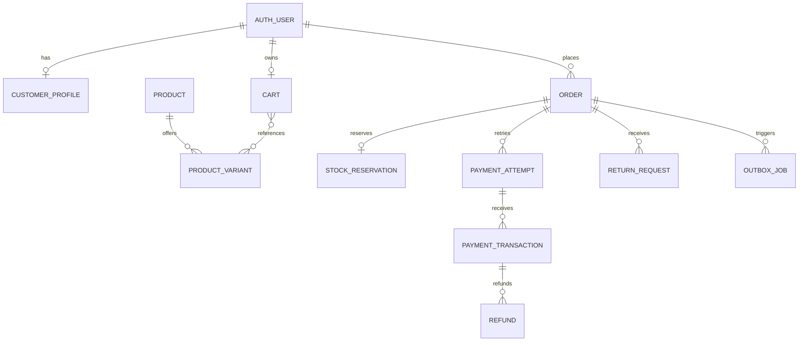

# OFFHOUR — Database Design

**Version:** 1.0  
**Date:** 10 November 2026  
**Status:** Design baseline; no database provisioned  
**Related requirements:** [OFFHOUR PRD](./OFFHOUR-PRD.md)

## 1. Purpose and boundaries

Design the MongoDB data model for OFFHOUR's responsive clothing-store prototype. The application is a Next.js/Node.js modular monolith hosted on Vercel, using MongoDB Atlas Free, Better Auth, and Razorpay test payments.

The design supports catalog browsing, Google and email/password authentication, persistent customer carts, checkout, stock reservations, payments, order history, cancellation, and return/exchange requests. Co-ord sets have one size for the complete set.

The eventual target of 5,000 concurrent visitors is context for future capacity testing, not a capacity promise or prototype acceptance requirement. This design prioritizes correct behavior under contention; free-tier throughput must be measured independently.

Product images initially ship under `public/images/products/`. The database stores relative asset keys, allowing a configured media base URL to switch to S3/CDN later. Private return evidence uploads are deferred until persistent private file storage exists.

General email delivery remains restricted until a sending domain is configured. Authentication data supports verification and reset flows regardless of whether delivery uses development recipients or a production provider.

## 2. Core conventions

| Concern | Convention |
|---|---|
| Application document IDs | BSON ObjectId; serialize as strings at API boundaries |
| Authentication IDs | Adapter-managed; expose a canonical string user ID in the application |
| User references | `userId: string`, matching Better Auth's application-facing user ID |
| Timestamps | BSON Date in UTC; display in Asia/Kolkata where appropriate |
| Money | Nonnegative safe integers in paise; `currency: "INR"` |
| Quantities | Positive integers for requested quantities; nonnegative integers for counters |
| Common fields | `_id`, `createdAt`, `updatedAt`, `schemaVersion` on application collections |
| Optional unique references | Omit when absent; partial unique indexes restrict to populated values |
| Deletion | Archive catalog entries; preserve order and payment history |
| References | MongoDB has no foreign-key enforcement; application services validate references |
| Untrusted input | Validate server-side; never accept client totals, ownership, or stock as authoritative |

Better Auth collections follow the pinned library's actual schema rather than the application's common-field conventions. The implementation must verify adapter ID conversion before creating customer references. Do not mix BSON ObjectIds and string IDs in the same reference field.

Default prototype limits: 20 distinct cart lines, 5 units per variant per order, 10 saved addresses per customer. These are configurable application rules.

## 3. Collection map and relationships

| Collection | Responsibility |
|---|---|
| Better Auth `user`, `session`, `account`, `verification` | Identity, credentials, sessions, verification |
| `customerProfiles` | Commerce preferences and saved addresses |
| `products` | Product content and merchandising |
| `productVariants` | Sellable size/color combinations and stock |
| `carts` | One persistent cart per signed-in customer |
| `promotions` | Simple sample discount rules |
| `orders` | Purchase snapshots and customer-facing lifecycle |
| `stockReservations` | Durable reservation ownership and expiry |
| `paymentAttempts` | Razorpay order creation attempts and reconciliation |
| `paymentTransactions` | Individual Razorpay payments under an attempt |
| `webhookEvents` | Deduplicated payment event inbox |
| `returnRequests` | Return/exchange workflow |
| `refunds` | Explicit simulated or provider-backed refund records |
| `outboxJobs` | Durable email and recovery tasks |

Cart lines, addresses, order lines, and small status histories are embedded. Independently updated inventory, provider events, and asynchronous jobs are separate documents. Embedded arrays are bounded.

## 4. Authentication collections

Better Auth owns the physical schema and authentication writes. The names below are logical defaults and must be confirmed against the pinned adapter configuration.

| Collection | Expected core data | Rules |
|---|---|---|
| `user` | ID, name, email, emailVerified, image, timestamps | Normalize email consistently; unique identity email |
| `session` | ID, userId, token, expiresAt, timestamps, optional request metadata | Token uniqueness; expiry checked on every authentication |
| `account` | ID, userId, providerId, accountId, optional password hash/provider tokens | Unique provider identity pair; library handles password hashing |
| `verification` | ID, identifier, value, expiresAt, timestamps | Library controls token creation, validation, consumption, and storage representation |

Generate or inspect the library-required indexes during implementation. Do not assume the adapter automatically creates every uniqueness constraint. Confirm a unique index on the provider/account pair and on session tokens. Add expiry cleanup only in a manner compatible with the library.

Never expose account records, password hashes, session tokens, verification values, or OAuth tokens through commerce APIs. Do not automatically merge accounts merely because an unverified email matches. Account linking must follow the authentication library's verified-identity policy.

## 5. Customer profiles and addresses

### `customerProfiles`

| Field | Type | Meaning |
|---|---|---|
| `userId` | string | Unique auth identity reference |
| `phone` | string, optional | Normalized customer contact number |
| `theme` | enum, optional | `grey`, `white`, `dark`; browser setting remains available anonymously |
| `addresses` | Address[] | Maximum 10 saved addresses |
| `defaultAddressId` | ObjectId, optional | Must reference an address in this document |

Address shape: `_id`, `recipientName`, `phone`, `line1`, optional `line2`, `city`, `state`, `postalCode`, `country: "IN"`.

Store postcodes as strings, validated as six digits; format validation alone does not establish serviceability. Address and default-address changes use one atomic profile update. Removing the default address clears or replaces the pointer in that same update. Saved addresses are never read as the source of an already-placed order's address.

## 6. Catalog and inventory

### `products`

| Field | Type | Meaning |
|---|---|---|
| `slug` | string | Unique stable URL identifier |
| `name` | string | Display name |
| `category` | enum | `hoodies`, `oversized-tees`, `linen-shirts`, `co-ord-sets` |
| `status` | enum | `draft`, `active`, `archived` |
| `description` | string | Product copy |
| `fabric`, `careInstructions`, `fit` | string | Material, care, and fit details |
| `sizeGuide` | object | Unit `cm`, measurement labels and size rows; optional model measurements |
| `images` | object[] | `{ key, alt, sortOrder, colorCode? }` |
| `tags` | string[] | Collection and editorial labels |
| `featuredRank` | integer | Lower rank appears first in featured sort |
| `publishedAt` | Date, optional | New-arrival sorting |
| `relatedProductIds` | ObjectId[] | Small curated list |

Image key example: `products/offhour-heavy-hoodie/graphite-front.webp`. Keys contain no leading host or `public/` prefix. Image helpers resolve them to `/images/...` now and a configured external base later. Do not store expiring signed URLs as permanent asset references.

### `productVariants`

| Field | Type | Meaning |
|---|---|---|
| `productId` | ObjectId | Parent product |
| `sku` | string | Unique stock identifier |
| `size` | string | Controlled size code, such as `S`, `M`, `L`, `XL` |
| `colorCode` | string | Stable normalized code, such as `graphite` |
| `colorName`, `colorHex` | string | Display label and swatch |
| `pricePaise` | integer | Authoritative sale price |
| `compareAtPricePaise` | integer, optional | Must exceed sale price if present |
| `currency` | literal | `INR` |
| `status` | enum | `active`, `archived` |
| `stockOnHand` | integer | Unsold physical units, including reserved units |
| `stockReserved` | integer | Units held by active reservations |

**Inventory invariant:** `0 <= stockReserved <= stockOnHand`. Available stock is `stockOnHand - stockReserved`; it is calculated, not independently maintained.

Reservation increases `stockReserved`. Successful purchase decreases both counters. Reservation release decreases only `stockReserved`. Returned goods increase `stockOnHand` only after an explicit accepted-restock operation, not merely when a return is requested.

One co-ord SKU represents a complete top/bottom set in the same size. No separate topSize or bottomSize fields exist.

Catalog filters join against variants. Size, color, availability, and price conditions must match the same variant. Sort price is the minimum price among eligible active variants. A simple case-insensitive, escaped product-name search is acceptable for the small seed catalog; it is a bounded collection scan, not a claim of indexed full-text search. Add specialized search only after measurement.

## 7. Carts and promotions

### `carts`

Fields: `userId`, `items: [{ variantId, quantity, addedAt }]`, optional `promotionCode`, `version: integer`.

There is one cart per signed-in user. Variant IDs are unique within the items array through server-side validation. Cart mutations use an expected `version` and increment it to prevent lost updates; stale clients reload and retry.

Anonymous carts live in browser storage. On login, merge them into the database cart: combine matching variants, enforce quantity limits, report unavailable items, and clear the anonymous cart only after success. Use the cart version and an atomic `lastMergeToken` field to make retries of the same browser merge idempotent. Explicit user-triggered merges are serialized per browser.

Cart prices are display estimates. Checkout recomputes every amount. Successful checkout removes only purchased quantities from the latest cart, preserving additions made after checkout began; apply this once in the purchase transaction.

### `promotions`

Fields: `codeNormalized`, `status: active|inactive`, `kind: percentage|fixed`, `basisPoints?`, `amountPaise?`, `minimumSubtotalPaise`, optional `maximumDiscountPaise`, `startsAt`, `endsAt`, optional `eligibleCategories`.

For percentage discounts, calculate using integer basis points and an explicit rounding rule. Version 1 has a simple seeded code without global redemption caps or per-user usage limits. Those features would require additional atomic redemption records.

Persist the promotion rule snapshot and allocated per-line discount in the order. Allocate rounding remainders deterministically so line discounts sum exactly to the order discount.

## 8. Orders

### `orders`

| Field | Type | Meaning |
|---|---|---|
| `orderNumber` | string | Unique customer-facing reference; never an access credential |
| `userId` | string | Owner |
| `checkoutKey` | string | Customer-scoped idempotency key |
| `requestHash` | string | Hash of canonical checkout input; detects key reuse with changed input |
| `cartVersion` | integer | Source cart version |
| `mode` | literal | `test` |
| `items` | OrderLine[] | Immutable purchase snapshots |
| `shippingAddress` | Address snapshot | Independent of saved-address edits |
| `contactEmail`, `contactPhone` | string | Order communication snapshots |
| `totals` | object | `subtotalPaise`, `discountPaise`, `shippingPaise`, `totalPaise`, `currency` |
| `promotionSnapshot` | object, optional | Applied rule and normalized code |
| `pricingPolicyVersion` | string | Shipping/discount policy used |
| `status` | enum | `pending_payment`, `confirmed`, `cancelled`, `expired`, `payment_review` |
| `paymentStatus` | enum | `pending`, `paid`, `failed`, `partially_refunded`, `refunded` |
| `fulfillmentStatus` | enum | `unfulfilled`, `processing`, `shipped`, `delivered`, `partially_returned`, `returned`, `cancelled` |
| `acceptedPaymentTransactionId` | ObjectId, optional | Exactly one payment funds this order |
| `reservationId` | ObjectId | Reservation reference |
| `expiresAt` | Date | Payment/reservation deadline |
| `paidAt`, `shippedAt`, `deliveredAt`, `cancelledAt` | Date, optional | Lifecycle milestones |
| `tracking` | object, optional | Carrier, tracking reference/link, `isSimulated` |
| `cancellation` | object, optional | Requested time, reason, decision, resolution time |
| `history` | bounded object[] | State changes with time, actor, reason, optional source event ID |

Order line: `_id`, `productId`, `variantId`, `sku`, `productSlug`, `name`, `size`, `colorName`, `imageKey`, `unitPricePaise`, `quantity`, `lineSubtotalPaise`, `discountPaise`, `lineTotalPaise`, `returnRequestedQuantity`, `returnedQuantity`, `refundedPaise`.

All amounts come from server calculations. `subtotal = sum(lineSubtotal)`, `discount = sum(lineDiscount)`, and `total = subtotal - discount + shipping`. Discounts cannot exceed eligible subtotal. Prototype prices are treated as final displayed prices; tax invoicing and tax breakdowns must be specified before a live launch rather than inventing a tax calculation here.

History is bounded to 100 entries for the prototype. Machine retry logs belong in operational records rather than this array.

## 9. Stock reservations and checkout consistency

### `stockReservations`

Fields: `orderId`, `items: [{ variantId, quantity }]`, `status: active|consumed|released`, `expiresAt`, optional `consumedAt`, `releasedAt`, `releaseReason`.

Default hold duration is 10 minutes, configurable. Expiry is a logical business deadline. Do not TTL-delete reservation records: deletion would lose the evidence required to release stock and reconcile late payments.

### Reserve transaction

1. Authenticate the customer, validate ownership and checkout input, and calculate server-authoritative prices.
2. In a short MongoDB transaction, check the customer-scoped checkout key. Return the existing order for an identical request; reject a mismatched request hash.
3. Revalidate the chosen variants and prices within the transaction. For every line, conditionally increment `stockReserved` only where the variant is active and available stock is at least the requested quantity.
4. If any line cannot reserve, abort the entire transaction.
5. Insert the order, active reservation, pending payment-attempt record, and recovery job atomically.
6. Commit before contacting Razorpay. Never call external services inside a transaction that may retry.

Use bounded transaction retries for write conflicts. Return a retryable error if exhausted. Create collections and indexes before transactional checkout begins.

### Payment success transaction

After provider verification, match internal order, provider order, currency, amount, and mode. If the reservation is active and unexpired, atomically consume it, decrement both inventory counters, accept the payment, confirm the order, update purchased cart quantities, and insert a uniquely keyed confirmation-email job.

Duplicate notifications become no-ops. The transaction conditionally checks the current reservation and order state, so stock consumption cannot race successfully with stock release.

### Expiry and late payment

An expiry processor atomically changes active reservations to released and decreases reserved counters. Scheduled processing is preferred; bounded opportunistic cleanup during checkout is an additional recovery path. Vercel request-local timers are never the mechanism.

A late verified captured payment does not automatically consume stock. Mark the order `payment_review`, retain the payment evidence, and attempt a fresh all-items allocation transaction. If available, deduct unreserved stock and confirm exactly once; otherwise queue manual test-refund resolution. Never oversell to accommodate late payment.

Expiry processing may be delayed; until it runs, expired holds can reduce apparent availability. This is conservative and safe. Frequent cleanup is an operational dependency, not a property provided by TTL indexes.

## 10. Payments and webhook inbox

### `paymentAttempts`

One record represents one internal attempt to create/use a Razorpay order. A Razorpay order may produce multiple individual payments, so payments are separate records.

Fields: `orderId`, `attemptNumber`, `provider: razorpay`, `mode: test`, `receipt`, optional `providerOrderId`, `amountPaise`, `currency`, `status: creating|ready|creation_unknown|closed`, `creationLeaseUntil?`, `lastCheckedAt?`, `lastErrorCode?`, `nextCheckAt?`.

Creation is claimed by one worker/request using a lease. Save the returned provider order ID before exposing checkout details. If an external call times out after provider creation, mark the result unknown and reconcile using provider records before retrying creation. Do not assume the provider offers an idempotent order-creation API merely because our internal key is unique.

Retries reuse a valid provider order where possible. A replacement attempt is created only after resolving or closing the prior attempt. All attempts still refer to the same immutable internal order total.

### `paymentTransactions`

Fields: `paymentAttemptId`, `orderId`, `providerPaymentId`, `providerOrderId`, `mode`, `amountPaise`, `currency`, `providerStatus`, `verifiedAt?`, `capturedAt?`, `disposition: pending|accepted|duplicate|review|failed`, optional sanitized failure code, `refundedPaise`.

Only a verified captured payment can fund an order. Authorization alone is not settlement. Retain each provider payment independently. If an additional captured payment arrives for an already funded order, classify it as duplicate and open a recovery/refund job; do not silently discard it or fulfill twice.

### `webhookEvents`

Fields: `provider`, `mode`, `eventId`, `eventType`, `providerPaymentId?`, `providerOrderId?`, minimal validated payload, `payloadHash`, `status: pending|processing|processed|failed`, `attempts`, `leaseUntil?`, `nextAttemptAt`, `processedAt?`, `lastErrorCode?`.

Verify the webhook signature against the original request bytes before accepting an event. Insert using the unique event key, then process with a recoverable lease. Only mark processed after the database changes commit. A crash between commit and acknowledgement is safe because domain writes are also idempotent. Do not depend on event delivery order; ambiguous state triggers a provider lookup.

Retain minimized test event records for 30 days after successful processing using a `purgeAt` date. Failed or unresolved events have no purge date. Never persist full payment instruments, secrets, or unnecessary raw payloads.

## 11. Returns, exchanges, cancellations, and refunds

### `returnRequests`

Fields: `userId`, `orderId`, `requestKey`, `kind: return|exchange`, `items: [{ orderLineId, quantity, requestedVariantId? }]`, `reasonCode`, optional `comments`, `status: requested|approved|rejected|received|completed|cancelled`, `policySnapshot`, `pickupFeePaise`, bounded `history`, optional `replacementOrderId`, `isSimulated: true`.

Requests are eligible through seven elapsed days after `deliveredAt`; store the computed `eligibleUntil` in the policy snapshot and apply `now <= eligibleUntil`. The prototype uses one delivery timestamp per order. Policy snapshot includes version, window, fees, and declared unworn/unwashed/tags conditions. Physical condition is confirmed during inspection, not inferred from a database flag.

In one transaction, validate ownership and eligibility, ensure requested quantities do not exceed purchased quantities minus previously returned or actively requested quantities, increment each line's `returnRequestedQuantity`, and insert the request. Rejection/cancellation releases that quantity once. Acceptance/completion adjusts requested/returned counters exactly once.

Exchange targets must belong to the same product and color and change only size for version 1. Availability at request time is advisory. Reserve replacement stock on approval through the same stock service; do not promise an exchange solely because it was requested. A linked replacement order must be explicitly identified as an exchange and must not open a second customer payment. Prototype fulfillment is manual/simulated.

Cancellation is permitted before shipment. Race cancellation and dispatch through conditional order transitions. An unpaid cancellation releases an active reservation transactionally. Paid cancellation restores purchased stock once and creates a refund-resolution record; it does not pretend the provider has already refunded money.

### `refunds`

Fields: `orderId`, `paymentTransactionId`, `returnRequestId?`, `requestKey`, `amountPaise`, `currency`, `reason`, `executionMode: simulated|razorpay_test`, `status: requested|processing|succeeded|failed`, `providerRefundId?`, `completedAt?`, bounded error details.

Version 1 defaults to simulated resolution. Explicit test-provider refunds may be enabled later. Simulated refunds must be labeled as such in the UI and never presented as provider-confirmed refunds. Allocate line discounts when computing partial refunds, enforce cumulative refunds no greater than captured payment, and prevent multiple pending requests from overcommitting refundable balance through transactional reservation of refund amounts. Update order refund totals only once on success. Returning inventory and refunding money are separate operations.

## 12. Durable jobs

### `outboxJobs`

Fields: `type`, `dedupeKey`, `aggregateId`, minimal `payload`, `status: pending|running|completed|failed`, `attempts`, `runAt`, `leaseUntil?`, `lastErrorCode?`, `completedAt?`, `purgeAt?`.

Job types include order email, reservation cleanup, payment reconciliation, and refund review. Insert jobs in the same transaction as the state that requires them. Claim due jobs atomically; expired leases may be reclaimed. Use bounded retries and retain failed jobs for inspection.

Email delivery is at least once unless the provider's idempotency capability is configured; a unique job key alone cannot guarantee exactly-once external delivery after a crash. Email failure must never roll back a paid order. Development email recipients are configured outside the database; reset links and credentials must not appear in job logs.

This collection requires an actual invocation mechanism: a secured scheduled endpoint or explicit developer-run recovery command. Until scheduling is configured, recovery is manual and must be disclosed during prototype review. Do not claim immediate background processing from a database record alone.

## 13. Index plan

Every collection receives MongoDB's default unique `_id` index. The following application indexes are created by a versioned setup script, never per request. `U` means unique. Partial indexes on optional provider IDs include only string-valued populated fields.

| Collection | Index keys / options | Query or invariant |
|---|---|---|
| `customerProfiles` | `userId: 1` U | One profile per identity |
| `products` | `slug: 1` U | Product lookup |
| `products` | `status: 1, category: 1, publishedAt: -1, _id: -1` | Category/newest listing |
| `products` | `status: 1, featuredRank: 1, _id: 1` | Featured listing |
| `productVariants` | `sku: 1` U | SKU uniqueness |
| `productVariants` | `productId: 1, size: 1, colorCode: 1` U | One size/color combination per product |
| `productVariants` | `productId: 1, status: 1, pricePaise: 1` | Product variant retrieval |
| `carts` | `userId: 1` U | One cart per user |
| `promotions` | `codeNormalized: 1` U | Code lookup |
| `orders` | `orderNumber: 1` U | Public reference |
| `orders` | `userId: 1, checkoutKey: 1` U | Checkout retry safety |
| `orders` | `userId: 1, createdAt: -1, _id: -1` | Account order history |
| `stockReservations` | `orderId: 1` U | One hold per checkout order |
| `stockReservations` | `status: 1, expiresAt: 1` | Expiry cleanup |
| `paymentAttempts` | `orderId: 1, attemptNumber: 1` U | Attempt sequencing |
| `paymentAttempts` | `provider: 1, mode: 1, providerOrderId: 1` U, partial | Provider order ownership |
| `paymentAttempts` | `status: 1, nextCheckAt: 1` | Reconciliation |
| `paymentTransactions` | `mode: 1, providerPaymentId: 1` U | Payment deduplication |
| `paymentTransactions` | `orderId: 1, createdAt: -1` | Order payment history |
| `webhookEvents` | `provider: 1, mode: 1, eventId: 1` U | Event deduplication |
| `webhookEvents` | `status: 1, nextAttemptAt: 1` | Pending event processing |
| `webhookEvents` | `purgeAt: 1`, TTL 0 | Completed event cleanup |
| `returnRequests` | `userId: 1, requestKey: 1` U | Request retry safety |
| `returnRequests` | `orderId: 1, createdAt: -1` | Per-order requests |
| `refunds` | `requestKey: 1` U | Refund retry safety |
| `refunds` | `providerRefundId: 1` U, partial | Provider refund deduplication |
| `refunds` | `paymentTransactionId: 1, createdAt: -1` | Refund history |
| `outboxJobs` | `dedupeKey: 1` U | One logical job per event |
| `outboxJobs` | `status: 1, runAt: 1` | Due jobs |
| `outboxJobs` | `purgeAt: 1`, TTL 0 | Completed job cleanup |

History pages use cursor pagination with `createdAt` and `_id` as the tie-breaker. Add indexes only for demonstrated queries: variant availability uses a calculated expression and is not assumed to be fully index-covered. TTL deletion is asynchronous and never substitutes for expiry checks. Job retention must exceed the replay window; financial/domain guards remain after operational records are purged.

## 14. Validation and access control

- Use shared server-side validation plus MongoDB validators for application-owned collections: required fields, BSON types, enums, integer bounds, and supported currency.
- Cross-document totals, reference validity, stock invariants, and state transitions are enforced in services and transactions.
- Authenticated reads and mutations filter by both resource ID and authenticated `userId`; the client cannot choose the effective owner.
- Public catalog responses exclude internal stock counters and operational fields; expose availability as needed.
- Never use order numbers or unguessable IDs as a substitute for authorization.
- Keep auth secrets, Razorpay secrets, MongoDB credentials, and email API keys in deployment configuration, not database documents.
- Apply rate limits to auth and payment creation. A per-process memory limiter is insufficient across Vercel instances; choose a shared implementation or explicit platform control during implementation.
- Use one reusable MongoDB client per warm runtime with a bounded connection pool. There is no single global pool across serverless instances.

## 15. Setup, seed data, and retention

1. Use separate development/test database names and never copy real customer data into seeds.
2. Pin the auth library/adapter, establish the ID contract, and create required auth indexes.
3. Run versioned, repeatable collection/index/validator migrations before deployment.
4. Seed stable SKUs/slugs across all four categories, including sold-out and partially unavailable products, one promotion, and clearly marked simulated order fixtures.
5. Keep seeds idempotent and non-destructive: reruns must not reset purchased stock or overwrite orders. A destructive fixture reset requires an explicit test-only action.
6. Retain orders, payments, reservations, refunds, and return requests throughout prototype testing. Do not TTL-delete them.
7. Use TTL only for eligible operational cleanup and library-compatible auth expiry cleanup. Check expiry in application logic regardless of cleanup timing.
8. Export database data before destructive changes; perform a restore test. Do not assume the selected free tier includes a sufficient managed backup policy.

## 16. Verification checklist

- Duplicate checkout submissions produce one internal order and one reservation.
- Reusing a checkout key with changed input fails clearly.
- Two customers competing for the final unit cannot both reserve it.
- Multi-item reservation failure rolls back all stock changes.
- Payment success racing expiry/cancellation cannot decrement or release stock twice.
- Provider timeout after order creation enters reconciliation rather than blind recreation.
- Duplicate and out-of-order webhooks do not duplicate fulfillment, refunds, or stock movements.
- A second captured payment creates a review/refund case, not a second fulfillment.
- Late payment without available stock enters review without overselling.
- Cart login-merge retries do not duplicate quantities; later cart additions survive purchase cleanup.
- Profile and catalog edits do not modify historical order snapshots.
- Return/exchange retries cannot exceed purchased quantities or refund balance.
- Expired auth/hold records are rejected even before cleanup runs.
- Customers cannot access another customer's address, order, payment, or return request.
- Crashed job processors can recover leases; failed email delivery does not change payment success.

## 17. Decisions deferred to implementation or live launch

- Pin exact library versions and finalize generated auth schema/indexes.
- Select a free-compatible scheduler and verify its cadence against reservation cleanup needs.
- Configure sending-domain-backed email before unrestricted tester/customer delivery.
- Configure private object storage before enabling return-photo uploads.
- Confirm shipping fees, final returns wording, taxes, and invoice requirements before live sales.
- Load-test before claiming any visitor or checkout capacity; consider admission control and paid database capacity only when required by evidence.

## 18. Technical references

- [Better Auth database concepts and core schema](https://better-auth.com/docs/concepts/database)
- [Better Auth MongoDB adapter](https://better-auth.com/docs/adapters/mongo)
- [MongoDB atomicity and transactions](https://www.mongodb.com/docs/manual/core/write-operations-atomicity/)
- [MongoDB transaction behavior](https://www.mongodb.com/docs/manual/core/transactions/)
- [MongoDB index properties](https://www.mongodb.com/docs/manual/core/indexes/index-properties/)
- [MongoDB TTL indexes and delayed deletion](https://www.mongodb.com/docs/manual/core/index-ttl/)

The collection boundaries and lifecycle rules above are OFFHOUR design decisions; the references establish the underlying database and authentication behavior.
